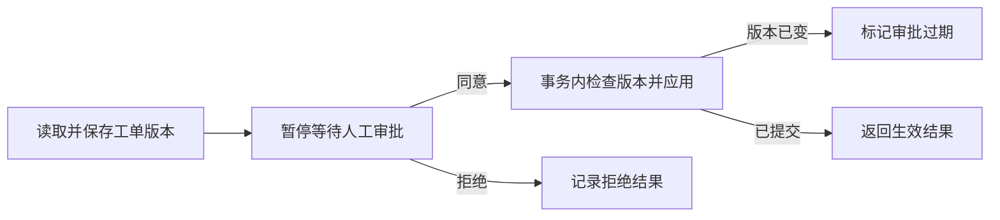

# LangGraph 工单审批实验室

一个在本机运行的人工审批工作流。把工单的当前版本保存成待审批快照，退出程序后再恢复。审批期间如果有人改了工单，旧的批准会被标为 `stale`，需要针对新版本发起审批。

A local LangGraph approval workflow with SQLite checkpoints, version-bound approvals and idempotent writes. It runs without a model API key.

## 快速开始

需要 Python 3.11 或更新版本。以下命令适用于 Windows PowerShell。

```powershell
python -m venv .venv
.\.venv\Scripts\python.exe -m pip install -r requirements.txt
.\.venv\Scripts\python.exe approval.py create T-042 "更新演示页面横幅"
.\.venv\Scripts\python.exe approval.py request T-042 review-1
.\.venv\Scripts\python.exe approval.py status review-1
.\.venv\Scripts\python.exe approval.py decide review-1 1 approve
.\.venv\Scripts\python.exe approval.py show T-042
```

`request` 返回待审的版本号和完整草稿。各命令在独立进程中运行，`decide` 根据审批编号从磁盘恢复。最后的 `show` 会显示生效内容和 `application_count: 1`。可用 `--data-dir` 指定另一份实验数据目录。

## 试一下过期审批

继续使用上面的工单。先改成版本 2 并发起审批，再改成版本 3。此时批准版本 2，流程会返回 `stale`，原先已生效的内容仍可用 `show` 查看。

```powershell
.\.venv\Scripts\python.exe approval.py revise T-042 "将横幅背景改为蓝色"
.\.venv\Scripts\python.exe approval.py request T-042 review-2
.\.venv\Scripts\python.exe approval.py revise T-042 "将横幅背景改为绿色"
.\.venv\Scripts\python.exe approval.py decide review-2 2 approve
.\.venv\Scripts\python.exe approval.py request T-042 review-3
.\.venv\Scripts\python.exe approval.py decide review-3 3 approve
```

## 流程与存储



- `workflow.py` 在准备节点保存草稿。审批节点通过 `interrupt()` 暂停，由同一个 `thread_id` 恢复。图使用 `SqliteSaver` 和同步检查点。
- `storage.py` 在一个 SQLite 写事务里检查工单版本、写入应用记录和更新生效内容。应用记录按审批编号去重，同一工单版本也只能生效一次。
- 如果数据库已提交，流程在保存完成状态前中断，`recover <审批编号>` 会恢复待执行的节点。重复执行会返回原有的应用结果。
- 运行数据默认保存在本地 `.approval-data/`。流程禁用 LangSmith 跟踪，示例命令使用虚构工单。

## 验证

```powershell
.\.venv\Scripts\python.exe -m unittest -v
```

测试覆盖跨进程恢复、拒绝、审批版本传错、过期审批、重复批准，以及数据库提交后中断的恢复。

[LangGraph 中断](https://docs.langchain.com/oss/python/langgraph/interrupts) · [检查点](https://docs.langchain.com/oss/python/langgraph/checkpointers)
